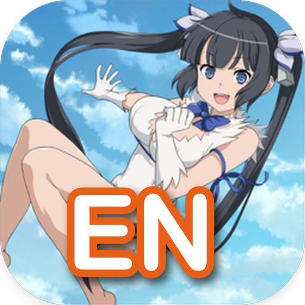
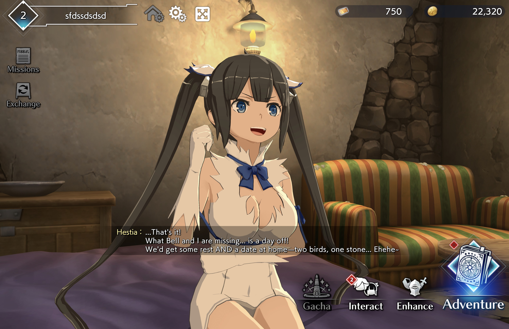
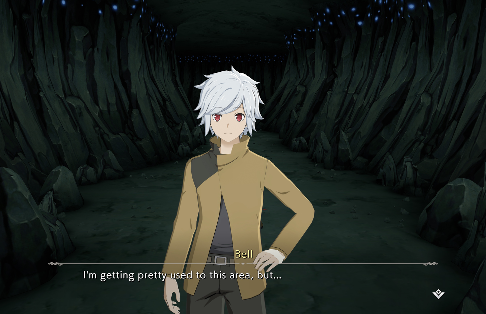
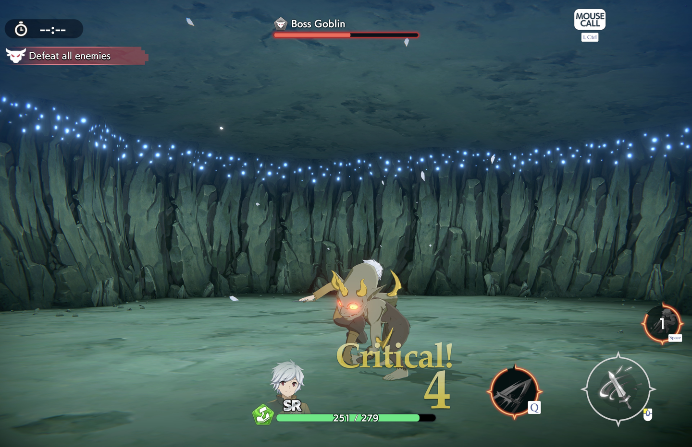
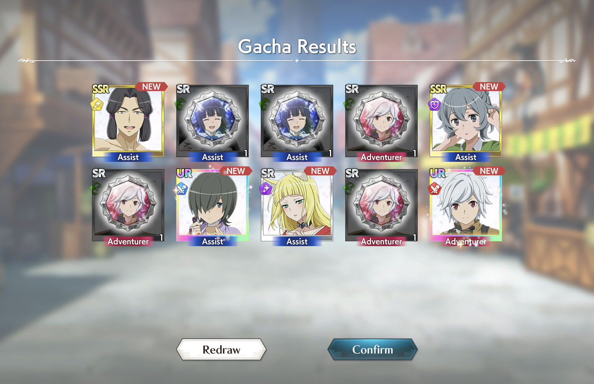
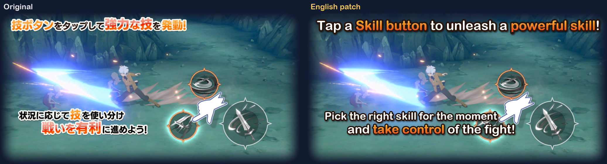

<p align="center"></p>

<h1 align="center">DanChro English Patch</h1>

<p align="center"><b>Play DanMachi Battle Chronicle's offline edition in English, with a gacha that respects your time.</b></p>

<p align="center">
  <a href="https://github.com/EY4O/danchro-english-patch/blob/main/LICENSE"></a>
  <a href="https://github.com/EY4O/danchro-english-patch/commits/main"></a>
  <a href="https://github.com/EY4O/danchro-english-patch/releases/latest"></a>
  <a href="https://ko-fi.com/looneth"></a>
</p>

An unofficial fan patch for the **offline edition** of *DanMachi Battle Chronicle* (ダンクロ), the version Aiming released after the online service ended on September 29, 2025. It translates the whole game into English, using the official Yen Press names and terms. You can also choose a rebalanced economy that suits a game with no more events or login bonuses. It works on Windows, and on Mac through Wine.



> **⚠ You need the offline edition of the PC game** (October 2025 build). The patch contains no game and works on no other version; the installer checks the files before changing anything.

---

## ✨ Key Features

- 🌐 **Full English translation**: about 56,000 strings of story, menus, skills, items and missions, with the names and terms of the Yen Press English release.
- 🖼️ **Translated images**: 405 images with Japanese drawn in, from tutorials and gacha banners to the "Pull!" prompt and 305 honor plates, redrawn in English in the game's style.
- 🎟️ **Fairer gacha**: every pull earns 5 exchange tokens, so each ten-pull buys any character you choose, and the top-rarity rate is 7.5% instead of 2.5%.
- 💎 **Crystals from the story**: first clears pay 150 / 300 / 500 crystals (normal / hard / very hard), about 26 ten-pulls across the story instead of 5.
- ⏩ **Less grind**: double EXP, gold and upgrade materials from quests.
- 🩹 **Smarter auto-battle**: healing skills and assists wait until someone drops below 70% HP instead of firing at full health.
- 🔊 **Sound fix for Wine**: keeps audio from cutting out after a few seconds on Mac and Linux.
- 🎚️ **Your choice**: install the full patch, or the translation alone with gameplay exactly as shipped. Switch any time, and uninstall cleanly.

## 📸 Screenshots

| | |
|---|---|
|  **Story**: every scene in English, voices untouched |  **Battle**: enemy names, objectives and HUD in English |
|  **Gacha**: results in English, and every ten-pull also earns 50 exchange tokens toward any character |  **Tutorials**: the original image (left) and the patched one |

---

## 📦 Installation

### Option 1: **Release installer** (Recommended)

1. Download `DanChro-English-Patch.zip` from the [latest release](https://github.com/EY4O/danchro-english-patch/releases/latest).
2. Close the game. Unzip it and put the `DanChro-English-Patch` folder inside the game folder, next to `danchro.exe`.
3. Run `install-windows.bat` (Windows) or `install-mac.command` (Mac: right-click → **Open** the first time).
4. Choose **1** for the full patch or **2** for translation only.

Your original files are backed up in the patch folder. `uninstall-windows.bat` / `uninstall-mac.command` restores them, and save data is never touched.

**Updating from an older version:** unzip the new patch over your existing `DanChro-English-Patch` folder, so its `backup` folder is kept, and run the installer again. Or run the old uninstaller first. The installer refuses to back up files that an older patch already changed.

### Option 2: **Build it from your own game files**

```bash
cd "<game folder>"
git clone https://github.com/EY4O/danchro-english-patch.git english-patch
```

Then follow [docs/DEVELOPMENT.md](docs/DEVELOPMENT.md#run-it-locally): it extracts what it needs from your copy, renders the tutorial images and installs the result.

<details>
<summary><b>Playing on a Mac (Apple Silicon)</b></summary>

The game is a Windows program, but it runs well under Wine, including fullscreen at native Retina resolution on an M2.

1. Install Rosetta 2: `softwareupdate --install-rosetta --agree-to-license`
2. Download [Gcenx's Wine Staging](https://github.com/Gcenx/macOS_Wine_builds) (11.18 tested).
3. Download [DXVK-macOS](https://github.com/Gcenx/DXVK-macOS), the `-repack-builtin` package. Copy its `d3d11.dll` and `d3d10core.dll` over the ones in `Wine Staging.app/Contents/Resources/wine/lib/wine/x86_64-windows/` (and `i386-windows/`). Without this step the game stops with "Failed to initialize graphics".
4. Install the patch (Option 1), then start the game from its folder:

```bash
"/path/to/Wine Staging.app/Contents/Resources/wine/bin/wine" danchro.exe -screen-fullscreen 1 -screen-width 2880 -screen-height 1864
```

Use your display's pixel size: the game's own **Screen Size** setting stops at 1920×1080.
</details>

## 🚀 Getting Started

1. Start the game as usual: `danchro.exe` on Windows, or through Wine on a Mac.
2. Open **Settings → Display Settings**. Set **Battle Resolution** and **Other Resolution** to **Highest** and turn **Anti-Aliasing** on.
3. Play the tutorial; it unlocks the rest of the menus as you go.
4. Pull on any element banner. The tokens you collect buy characters in **Exchange**.
5. Choose how each unit fights on auto in the formation's **AUTO Settings**: **Prioritize Attack**, **Prioritize Healing**, **Prioritize Strong Foes** or **Prioritize Lone Foes**.
6. Replay past event stories in **Memories**.

## 🗺️ Roadmap

What's still Japanese, mostly on purpose:

- Official series logos (*DanMachi*, *Familia Myth*, *Sword Oratoria*) and stylized event title logos, kept as artwork.
- The chrome 共闘決戦 ("Co-op Showdown") lettering on raid plates; the boss names under it are translated.
- Tiny labels inside loading-tip screenshots, too small to redraw legibly.

Spotted something else? Please open an issue with a screenshot.

---

## 📖 How It Works

<details>
<summary><b>🌐 Translation</b></summary>

All of the game's text lives in one local MasterMemory database (MessagePack with per-table LZ4) inside the `master_assets_all` bundle. The patch rewrites its dictionary table, about 58,700 keys, with English and rebuilds the bundle.

About 760 more strings are typed directly into screen layouts, in 3,876 text components across 43 bundles. Most are swapped for dictionary text at runtime, but some show as they are, such as the quest panel's headers. The patch writes English into all of them too. A few labels are shortened to fit boxes sized for Japanese, such as STR / END / DEX / MAG for the stats.

The text was translated with AI (Claude) in batches: names and terms first, then menus and descriptions checked against those names, and story scenes whole, with their speakers. Every batch is checked automatically: all entries present, `{placeholders}` and color tags intact, no Japanese left. Names that different batches rendered differently are then unified. Story chapter 1-1 and the character names were checked by hand.

It reads naturally, but it is not a professional human translation. Corrections are welcome (see Contributing).
</details>

<details>
<summary><b>🖼️ Images</b></summary>

Apple's Vision OCR scanned all 14,305 textures in the game for Japanese text. The Japanese is erased: whole boxes for headlines, only the letter pixels where text sits on artwork. English is then drawn in the game's style, such as white with orange emphasis, a dark outline and a shadow for headlines, or the plate's own colours for name plates. On shared sprite sheets only the text's own pixels change. Every tutorial and UI image was checked against the original by eye.

The 305 honor plates are generated: each plate's English title already exists in the translation, so a script redraws them, and a sample was reviewed. The Awakening / Mastery Up level-up effects are shader masks and glow maps, rebuilt with the same encoding as the originals.

Logos and art that would be damaged by erasing stay Japanese.
</details>

<details>
<summary><b>🎟️ Gacha and rewards (full patch)</b></summary>

The offline edition keeps five element banners at 300 crystals a pull, and the whole story paid about 15,000 crystals. The full patch changes the game's reward tables, not your save:

- **Exchange tokens**: 1 → 5 per pull (50 per ten-pull). Fifty tokens buy any of the 91 characters and assists in the exchange shop.
- **Rates**: top-rarity characters and assists 2.5% → 7.5% each, taken from the 3★ slots. The ten-pull's guaranteed top-rarity slot is unchanged.
- **Story first clears**: 30 / 100 / 0 → 150 / 300 / 500 crystals.
- **Quests**: character EXP, mastery, player EXP and gold ×2; upgrade-material drops ×2.
</details>

<details>
<summary><b>🩹 Auto-battle</b></summary>

Auto-battle follows behaviour trees stored in the game data. The default tactics fire every assist and skill the moment it is ready. The game's own **Prioritize Healing** tactic already checks for "HP below 70%" before healing; the patch adds that same check to **Prioritize Attack**, **Prioritize Strong Foes** and **Prioritize Lone Foes**. Heals then wait for damage, and damage and buff skills fire as before.
</details>

<details>
<summary><b>🔊 Sound and detail</b></summary>

- **Sound**: CRIWARE, the game's audio engine, renders through Windows spatial sound. Wine only partly implements that, so audio dies about 10 seconds in. The patch switches CRIWARE to plain stereo output (WASAPI). On Windows this only drops Windows Sonic spatial output.
- **Detail (full patch)**: the game boots on Unity's lowest quality preset, with a level-of-detail bias of 0.3. The patch raises it to 2.0 so models keep their detailed meshes further from the camera.
</details>

<details>
<summary><b>🛡️ Safety</b></summary>

- The installer checks every file it will replace before changing anything, and backs up the originals once.
- Save data (`AppData/LocalLow/aiming/danmachi_danchro`) is never read or written.
- Modified bundles get their checksum cleared in the asset catalog, so the game loads them.
- Uninstall restores the exact original files.
</details>

---

## 🧪 Development

Building, translating and releasing are described in **[docs/DEVELOPMENT.md](docs/DEVELOPMENT.md)**.

## 🤝 Contributing

Found a wrong line, a misnamed character or text that overflows its box? [Open an issue](https://github.com/EY4O/danchro-english-patch/issues) with a screenshot. For a fix, search `translations/` for the English text, edit it, and open a pull request. Keep `{placeholders}` and `<color>` tags exactly as they are.

## 🙏 Credits

- [Gcenx's macOS Wine builds](https://github.com/Gcenx/macOS_Wine_builds) and [DXVK-macOS](https://github.com/Gcenx/DXVK-macOS): running the game on a Mac
- [UnityPy](https://github.com/K0lb3/UnityPy): reading and writing the game's Unity bundles
- [msgpack-python](https://github.com/msgpack/msgpack-python) and [python-lz4](https://github.com/python-lz4/python-lz4): the game's database format
- [Cpp2IL](https://github.com/SamboyCoding/Cpp2IL): mapping the game's code during research
- [Claude](https://claude.ai) by Anthropic: translation and tooling
- *Is It Wrong to Try to Pick Up Girls in a Dungeon?* (Fujino Ōmori, Yen Press English edition): names and terminology

## ☕ Support

If the patch let you finally play DanChro in English, you can support my projects:

[](https://ko-fi.com/looneth)

## 📄 License

The tools are [MIT](LICENSE)-licensed. *DanMachi Battle Chronicle* and everything in it, including the original text the translation is based on, belong to Aiming and the DanMachi rights holders. This is an unofficial fan project with no affiliation to them, and it does not include or help you obtain the game.
